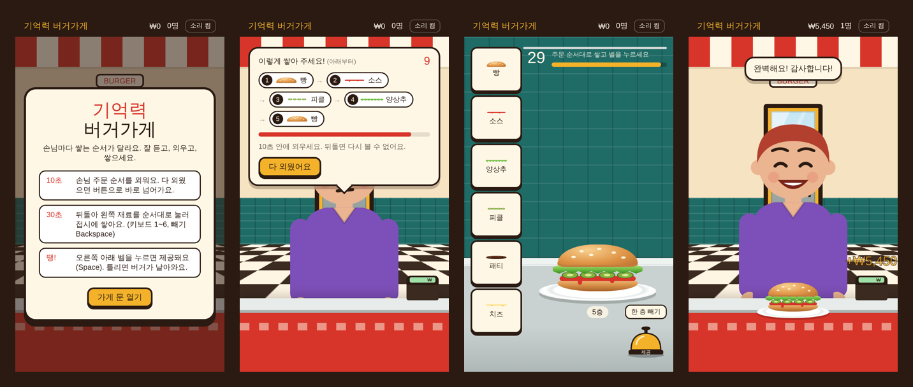

# 기억력 버거가게

손님이 말한 버거 쌓는 순서를 **10초** 안에 외우고, 뒤돌아서 **30초** 안에 똑같이 쌓아 벨을 누르는 모바일 웹 게임입니다.
틀리면 손님이 버거를 던집니다.



## 플레이하기

**https://&lt;GitHub 아이디&gt;.github.io/&lt;저장소 이름&gt;/**

모바일 브라우저에서 열고 "홈 화면에 추가"하면 앱처럼 전체 화면으로 실행되고, 한 번 연 뒤에는 오프라인에서도 동작합니다.

## 규칙

| 단계 | 시간 | 할 일 |
|---|---|---|
| 주문 | 10초 | 손님이 원하는 재료 순서(아래부터)를 외웁니다. 다 외웠으면 버튼으로 바로 넘어갈 수 있어요. |
| 조리 | 30초 | 왼쪽 재료(빵·소스·양상추·피클·패티·치즈)를 순서대로 눌러 접시에 쌓습니다. |
| 제공 | - | 오른쪽 아래 벨을 누르면 제공. 맞으면 돈을 받고, 틀리거나 시간이 지나면 게임 오버. |

- 성공할수록 주문이 한 층씩 길어지고(최대 13층), 손님 줄도 길어집니다.
- 6번째 손님부터는 중간에 빵이 들어가는 주문이 나옵니다.
- 남은 시간만큼 팁이 붙습니다.

### 키보드 (PC)

| 키 | 동작 |
|---|---|
| `1`~`6` | 재료 놓기 |
| `Backspace` | 한 층 빼기 |
| `Space` / `Enter` | 벨 (제공) |

## 구조

빌드 도구나 의존성 없이 정적 파일만으로 동작합니다.

```
index.html             게임 전체 (HTML·CSS·JS 한 파일)
manifest.webmanifest   홈 화면 앱 설정
sw.js                  오프라인 캐시 (서비스 워커)
icon-192.png, icon-512.png
.github/workflows/pages.yml   main에 push하면 GitHub Pages로 자동 배포
```

## 로컬에서 실행

```bash
python3 -m http.server 8080
# http://localhost:8080
```

## 수정 후 배포할 때

`sw.js`의 `CACHE` 값(예: `burger-v1` → `burger-v2`)을 올려야 이미 설치한 휴대폰에도 새 버전이 반영됩니다.

## 라이선스

[MIT](LICENSE)
